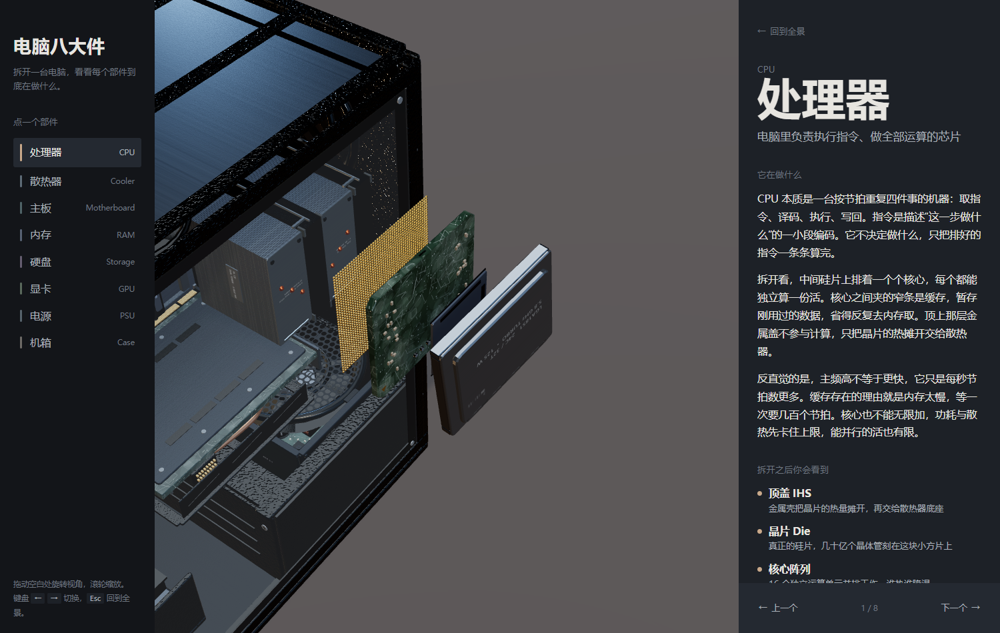

# 电脑八大件 · 拆解讲解

一台机器的剖面图：**开场八件依次飞进机箱组装起来，点哪一件，它就沿侧板抽出来在你面前拆开**。

打开后先看到的是一台立式机箱，八个部件按真实装机位置装在里面
（主板贴着背板、处理器在插座上、散热器压在处理器上、显卡横插在 PCIe 上、
内存在处理器右边、固态在主板下沿、电源沉在底部）。整机装好之后，
点左侧列表或直接点场景里的任意一件 —— 它从打开的侧板那一侧抽出来，
镜头沿弧线绕到它面前，同时它拆成爆炸图，右侧面板展开讲它的原理。

没有滚动叙事，没有加载动画，没有服务器：**双击一个 HTML 文件就能看**。




---

## v1.1.0：把模型从"积木"做到"零件"

v1.0.0 的八个部件是正确的，但都是**孤零零的形体**。这一版按
[docs/DETAIL-SPEC.md](docs/DETAIL-SPEC.md)（八大件真实机械规格调研，带来源）重做了一遍：
全案三角面 **46,288 → 171,359**（3.7 倍），零件数 **1,000 → 2,000+**。

三件事决定"像不像真硬件"，按性价比排序：

1. **表面**。`src/engine/detail.js` 用 Canvas 程序化生成六种贴图 —— PCB 走线/过孔/丝印、
   金属拉丝、磨砂颗粒、冲孔网、丝印铭牌。全部挂在 `kit.js` 的共享材质上，改一处八件受益。
2. **小零件密度**。LGA1851 的 **1845 个触点**、内存的 **288 位置金手指**、
   M.2 的 **134 个触点**、显卡的 **14 相供电**、主板的 **16 相供电 + 400 个插座触点**、
   散热器的 **双塔各 53 片鳍片 + 6 根真弯管**、机箱的 **6 把风扇**。
3. **倒角**。所有大块改用 `D.chamferGeo`（`ExtrudeGeometry` + bevel）——
   数学锐边接不住高光，轮廓立不起来，再细也像塑料。

顺带修掉两处**只有出图才看得见**的坑：冲孔网在远处会退化成满屏噪点（真透孔 + alphaTest +
mipmap 的经典问题，改成低频明暗示意）；`Box3` 会把 `InstancedMesh` 的实例算进包围盒，
排布越界会顶破自动机位的包围球。

---

## 直接看

下载 `电脑八大件.html`，双击。就这一步。

- 不需要联网（three.js 已内联进文件）
- 不需要装任何东西
- 不需要起本地服务器

---

## 八个部件

按装机顺序排的，点左边的列表或直接点场景里的部件：

| 部件 | 讲的是什么 |
|---|---|
| 处理器 CPU | 取指—译码—执行；缓存为什么存在；为什么主频高不等于更快 |
| 散热器 Cooler | 热量是被**传导**走的，不是被吹走的；瓶颈常在接触面 |
| 主板 Motherboard | 它本身不干活，负责让所有东西互相说话；走线为什么要等长 |
| 内存 RAM | 一个电容存 1 bit；为什么要不停刷新；带宽 ≠ 容量 |
| 硬盘 SSD | 写以页为单位、擦以块为单位 —— 这是掉速与磨损的根源 |
| 显卡 GPU | 几千个小核做同样的事；为什么显存带宽比容量关键 |
| 电源 PSU | 整流 → 高频变压 → 再整流；50%–60% 负载时效率最高 |
| 机箱 Case | 唯一的原理是**风道**；正压负压决定积灰在哪 |

每个部件拆开时都能看见它的真实结构：CPU 的核心阵列与顶盖、显卡的 SM 簇、
电源的变压器与电容组、机箱的风道粒子。

---

## 操作

| 操作 | 效果 |
|---|---|
| 点部件 / 点左栏 | 它从机箱侧板抽出来，镜头绕过去，拆开，面板滑入 |
| 拖动 | 自由环绕（上下左右都按你手的方向走） |
| 滚轮 | 推近拉远 |
| `←` `→` | 上一个 / 下一个部件 |
| `Esc` / 点空白 | 装回机箱，回到全景 |

调试单个部件：在网址后加 `?part=cpu&t=1`（`t` 是拆解进度，0 合拢 / 1 拆开）。
`?motion=off` 可以关掉所有动画和装配动画（截图、低性能设备用）。

---

## 它是怎么做的

```
src/
├── engine/
│   ├── stage.js     渲染器 / 场景 / 灯光 / 环境贴图
│   ├── camera.js    镜头机位与平滑飞行（二次贝塞尔弧线）
│   ├── kit.js       共享材质库 + 几何脚手架
│   └── detail.js    细节层：程序化贴图（PCB 走线/拉丝/磨砂/丝印/网孔）+ 细零件库
├── parts/           八个元件，一个文件一个部件
│   ├── gpu.js       ← 建议先读这个（28k 面级，把 detail.js 的用法示范全了）
│   ├── cpu.js  cooler.js  ram.js  storage.js
│   └── motherboard.js  psu.js  case.js
├── data/
│   ├── copy.js      讲解文字（纯数据）
│   └── layout.js    装配位置表：每件装在哪、朝哪、多大 —— 场景的真相
├── main.js          装配、交互、帧循环
├── tokens.css       设计 token（配色 / 字号 / 间距）
└── ui.css           外壳

docs/
├── DETAIL-SPEC.md   八大件真实机械规格调研（带来源 URL）—— 精细化改造的依据
├── overview.png     首页截图
└── panel.png        拆解态 + 讲解面板截图
```

**关于"像不像真硬件"**：形体比例只占一半，另一半是**表面**。所以有个 `detail.js`：
PCB 的走线/丝印/过孔、金属拉丝、磨砂颗粒、冲孔网、丝印铭牌全部是**程序化生成**
（`CanvasTexture`，不加载任何图片），再统一挂到 `kit.js` 的共享材质上 ——
改一处，八件同时受益。所有大块都用带倒角的挤出几何，因为**锐边接不住高光**，
轮廓立不起来就会像塑料积木。

几个刻意的选择：

**配色是莫兰迪色扇，不是彩虹。** 八个部件各有一个标识色（暖砂 / 灰青 / 灰蓝 /
灰紫 / 灰绿 / 灰赭 / 灰天 / 灰米），饱和度压在 25% 以下。但这个颜色只用在
**标识**上 —— 走线、数据流光点、指示灯、图例色点。部件本体一律走中性材质，
所以八个摆在一起是一族的。选中某件时，背景穹顶的色温会朝它的颜色偏一点点，
脚下地面也跟着染一丝 —— 不是给画面上色，是给氛围调温。

**灰不灰，关键在光不在材质。** 低饱和材质配中性光必然发灰，所以棚光做成了
一侧暖（约 3000K）一侧冷（约 7000K）的双色柔光箱，环境贴图也用这五块面片烘出来，
底色再垫一层暖灰。这样中性材质上会同时有暖面和冷面，体积感是光给的，
而不是靠提高饱和度。

**"多镜头"靠的是弧线，不是直线拉近。** 每次切机位，相机位置沿一条二次贝塞尔
曲线掠过（控制点在路径中点向上向外鼓起），注视点单独平滑跟随。这带来一种
"绕过去看"的体感，而不是缩放。

**每个部件是独立模块。** 只要求导出一个 `{ id, name, hue, focus, build(kit) }`，
`build` 返回 `{ group, setExplode(t), update(elapsed, dt) }`。
`setExplode` 必须是**纯函数式**的 —— 位置全部由 `t` 直接算出，不累积 `dt`，
所以可以来回擦洗而不跑偏。接口细节见 [CONTRACT.md](CONTRACT.md)。

---

## 本地开发

```bash
npm install
npm run dev      # esbuild 监听 + 本地服务 → http://127.0.0.1:5180/index.html
npm run build    # → dist/电脑八大件.html（单文件，双击即开）
npm run audit    # 纯 Node 静态验收八个元件（尺寸/面数/拆解可逆性/文案契约）
npm run place    # 纯 Node 验收装配：装不装得进机箱 / 有没有穿模 / 机位留白够不够
npm run check    # 上面两条一起跑
```

`npm run audit` 是一条**不开浏览器**的验收通道：它用 esbuild 把 `three` 别名指到
`vendor/three.module.js`，在 Node 里把八个元件真的建出来，逐物体比对
`setExplode(0→1→0)` 的 position/quaternion 是否复原、跑 60 帧 `update` 看有没有 NaN、
量 21 档拆解进度下的包围盒。速度快、零渲染开销，适合改完几何马上过一遍。

`npm run place` 是它的姊妹工具：按 `layout.js` 把八件摆进机箱，量出每件装配态的
世界包围盒，检查是否都落在内腔里、两两有没有穿模（唯一允许的重叠是散热器压在
处理器上），再按每件的机位距离与 fov 算出**拆解态在画面里占多少**
—— 这个数必须 ≤80%，否则元件会被画面切角。显卡最贪，`main.js` 里的
`K_FOCUS` 就是照它定的。改了 `layout.js` 或 `K_FOCUS` 之后重跑这条。

> [!TIP] 如果你自己写截图脚本，**别用"等 N 秒"**
> 无头浏览器走软件渲染时帧率极低，而主循环对 `dt` 做了钳制，墙上时间 1 秒只推进
> 零点几秒动画 —— 实测等 6.5 秒时开场镜头还停在半路，量到的包围盒全是中间态。
> 要等就等页面自己的状态：`!window.__anatomy.rig.isFlying`（`tools/shoot.mjs` 的
> `--until` 就是干这个的）。

`npm run build` 会把 CSS 和 JS 内联进一个 HTML。之所以要内联：ES 模块在
`file://` 下会被 CORS 拦掉，所以打包成 IIFE 再内联，是"双击即开"唯一可靠的路径。

---

## 用到的现成东西

不做重复造轮子。开工前先搜过一轮 GitHub，结论是没有能直接用的成品
（详见提交历史里的检索记录），于是只借了两个现成件：

- **[three.js](https://github.com/mrdoob/three.js)** 0.180.0 — MIT，已本地化在 `vendor/`
- **[esbuild](https://github.com/evanw/esbuild)** — MIT，只用来打包

扫到过但没用上的：[nateherkai/scroll-craft](https://github.com/nateherkai/scroll-craft)
（滚动叙事引擎，面向营销落地页，与本主题不合）、
[arm-education/Graphical-Micro-Architecture-Simulator](https://github.com/arm-education/Graphical-Micro-Architecture-Simulator)
（ARM 微架构仿真器，是仿真器不是讲解，且无 license）。

内容参考：[woai3c/nand2tetris](https://github.com/woai3c/nand2tetris)（《计算机系统要素》中文版）。

## 许可

MIT。three.js 的许可见 `vendor/three-LICENSE.txt`。