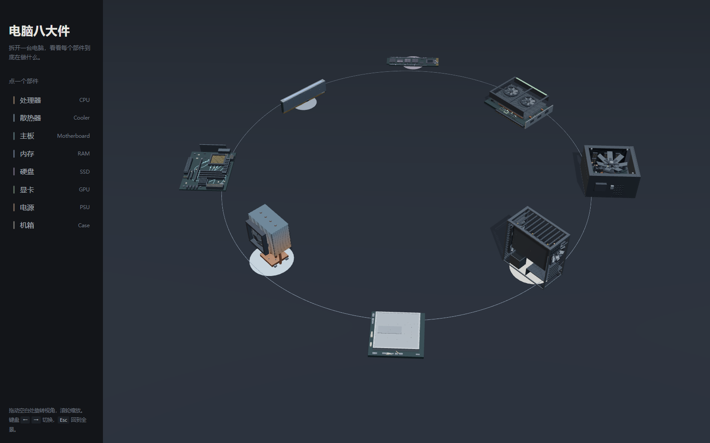

# 电脑八大件 · 拆解讲解

一个可点击的 3D 元件探索器：**点一个部件，镜头飞过去，它在你面前拆开**。

打开后八个部件悬在虚空里环成一圈。点其中任意一个 —— 相机沿一条弧线掠过，
停在那个部件面前；与此同时它从整机状态拆成爆炸图，右侧面板展开讲它的原理。

没有滚动叙事，没有加载动画，没有服务器：**双击一个 HTML 文件就能看**。



---

## 直接看

下载 `电脑八大件.html`，双击。就这一步。

- 不需要联网（three.js 已内联进文件）
- 不需要装任何东西
- 不需要起本地服务器

---

## 八个部件

按装机顺序排的，点左边的列表或直接点场景里的部件：

| 部件 | 讲的是什么 |
|---|---|
| 处理器 CPU | 取指—译码—执行；缓存为什么存在；为什么主频高不等于更快 |
| 散热器 Cooler | 热量是被**传导**走的，不是被吹走的；瓶颈常在接触面 |
| 主板 Motherboard | 它本身不干活，负责让所有东西互相说话；走线为什么要等长 |
| 内存 RAM | 一个电容存 1 bit；为什么要不停刷新；带宽 ≠ 容量 |
| 硬盘 SSD | 写以页为单位、擦以块为单位 —— 这是掉速与磨损的根源 |
| 显卡 GPU | 几千个小核做同样的事；为什么显存带宽比容量关键 |
| 电源 PSU | 整流 → 高频变压 → 再整流；50%–60% 负载时效率最高 |
| 机箱 Case | 唯一的原理是**风道**；正压负压决定积灰在哪 |

每个部件拆开时都能看见它的真实结构：CPU 的核心阵列与顶盖、显卡的 SM 簇、
电源的变压器与电容组、机箱的风道粒子。

---

## 操作

| 操作 | 效果 |
|---|---|
| 点部件 / 点左栏 | 镜头飞过去，部件拆开，面板滑入 |
| 拖动 | 在机位之上自由环绕 |
| 滚轮 | 推近拉远 |
| `←` `→` | 上一个 / 下一个部件 |
| `Esc` | 回到全景 |

调试单个部件：在网址后加 `?part=cpu&t=1`（`t` 是拆解进度，0 合拢 / 1 拆开）。
`?motion=off` 可以关掉所有动画（截图、低性能设备用）。

---

## 它是怎么做的

```
src/
├── engine/
│   ├── stage.js     渲染器 / 场景 / 灯光 / 环境贴图
│   ├── camera.js    镜头机位与平滑飞行（二次贝塞尔弧线）
│   └── kit.js       共享材质库 + 几何脚手架
├── parts/           八个元件，一个文件一个部件
│   ├── cpu.js       ← 范例，其余七个照它的结构写
│   ├── gpu.js  ram.js  storage.js
│   └── motherboard.js  psu.js  cooler.js  case.js
├── data/copy.js     讲解文字（纯数据）
├── main.js          装配、交互、帧循环
├── tokens.css       设计 token（配色 / 字号 / 间距）
└── ui.css           外壳
```

几个刻意的选择：

**配色是莫兰迪色扇，不是彩虹。** 八个部件各有一个标识色（暖砂 / 灰青 / 灰蓝 /
灰紫 / 灰绿 / 灰赭 / 灰天 / 灰米），饱和度压在 25% 以下。但这个颜色只用在
**标识**上 —— 走线、数据流光点、指示灯、图例色点。部件本体一律走中性材质，
所以八个摆在一起是一族的。

**"多镜头"靠的是弧线，不是直线拉近。** 每次切机位，相机位置沿一条二次贝塞尔
曲线掠过（控制点在路径中点向上向外鼓起），注视点单独平滑跟随。这带来一种
"绕过去看"的体感，而不是缩放。

**每个部件是独立模块。** 只要求导出一个 `{ id, name, hue, focus, build(kit) }`，
`build` 返回 `{ group, setExplode(t), update(elapsed, dt) }`。
`setExplode` 必须是**纯函数式**的 —— 位置全部由 `t` 直接算出，不累积 `dt`，
所以可以来回擦洗而不跑偏。接口细节见 [CONTRACT.md](CONTRACT.md)。

---

## 本地开发

```bash
npm install
npm run dev      # esbuild 监听 + 本地服务 → http://127.0.0.1:5180/index.html
npm run build    # → dist/电脑八大件.html（单文件，双击即开）
npm run audit    # 纯 Node 静态验收八个元件（尺寸/面数/拆解可逆性/文案契约），不开浏览器
```

`npm run audit` 是一条**不开浏览器**的验收通道：它用 esbuild 把 `three` 别名指到
`vendor/three.module.js`，在 Node 里把八个元件真的建出来，逐物体比对
`setExplode(0→1→0)` 的 position/quaternion 是否复原、跑 60 帧 `update` 看有没有 NaN、
量 21 档拆解进度下的包围盒。速度快、零渲染开销，适合改完几何马上过一遍。

> [!TIP] 如果你自己写截图脚本，**别用"等 N 秒"**
> 无头浏览器走软件渲染时帧率极低，而主循环对 `dt` 做了钳制，墙上时间 1 秒只推进
> 零点几秒动画 —— 实测等 6.5 秒时开场镜头还停在半路，量到的包围盒全是中间态。
> 要等就等页面自己的状态：`!window.__anatomy.rig.isFlying`（`tools/shoot.mjs` 的
> `--until` 就是干这个的）。

`npm run build` 会把 CSS 和 JS 内联进一个 HTML。之所以要内联：ES 模块在
`file://` 下会被 CORS 拦掉，所以打包成 IIFE 再内联，是"双击即开"唯一可靠的路径。

---

## 用到的现成东西

不做重复造轮子。开工前先搜过一轮 GitHub，结论是没有能直接用的成品
（详见提交历史里的检索记录），于是只借了两个现成件：

- **[three.js](https://github.com/mrdoob/three.js)** 0.180.0 — MIT，已本地化在 `vendor/`
- **[esbuild](https://github.com/evanw/esbuild)** — MIT，只用来打包

扫到过但没用上的：[nateherkai/scroll-craft](https://github.com/nateherkai/scroll-craft)
（滚动叙事引擎，面向营销落地页，与本主题不合）、
[arm-education/Graphical-Micro-Architecture-Simulator](https://github.com/arm-education/Graphical-Micro-Architecture-Simulator)
（ARM 微架构仿真器，是仿真器不是讲解，且无 license）。

内容参考：[woai3c/nand2tetris](https://github.com/woai3c/nand2tetris)（《计算机系统要素》中文版）。

## 许可

MIT。three.js 的许可见 `vendor/three-LICENSE.txt`。